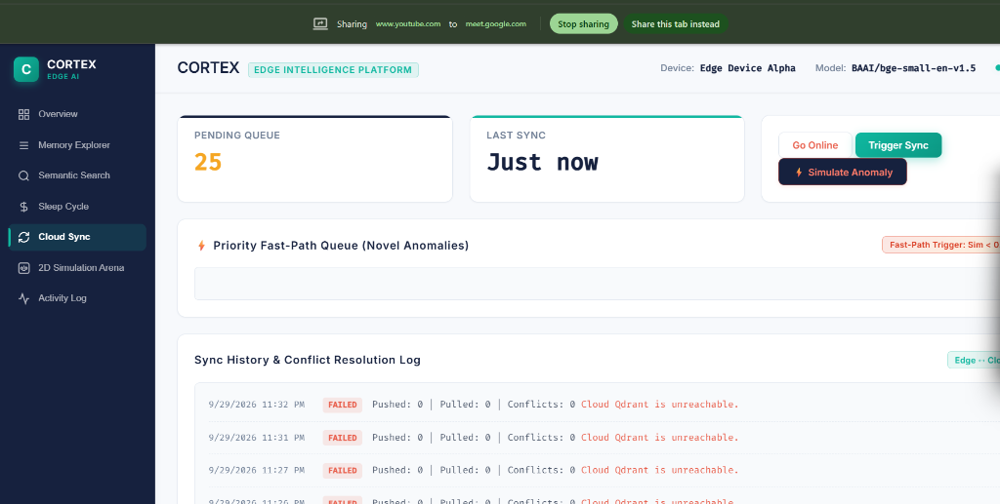
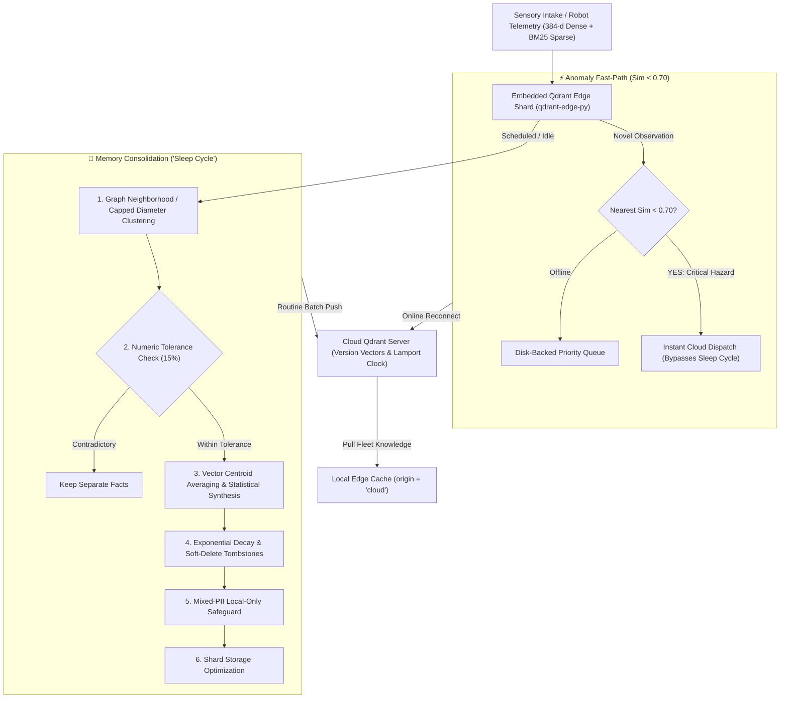

# CORTEX — Edge Memory & Intelligence Platform

> **AI-Powered Offline-First Vector Memory Engine with Qdrant Edge, BM25 Hybrid Search, Brain-Inspired Sleep Consolidation, and Anomaly-Triggered Priority Sync.**
> Built on **Qdrant Edge** (`qdrant-edge-py`) · Hackathon Problem Statement 03

[](https://cortex-edge-memory-platform.onrender.com/)
[](https://qdrant.tech/)
[](https://python.org/)
[](https://fastapi.tiangolo.com/)
[](LICENSE)
[](.github/workflows/ci.yml)

---

## 🌐 Live Demo

**👉 [https://cortex-edge-memory-platform.onrender.com/](https://cortex-edge-memory-platform.onrender.com/)**

The hosted instance runs a single edge node in `DEMO_MODE` with authentication disabled, so you can explore every tab of the Inspector Dashboard without any setup. Suggested first clicks:

1. **Overview** → click **Seed Sample Data** to load 39 noisy sensor logs.
2. **Search** → try the `ERR-4021` chip and flip between Dense, Sparse (BM25), and Hybrid (RRF).
3. **Sleep Cycle** → run a consolidation pass and watch near-duplicates collapse.
4. **Cloud Sync** → inject an anomaly, then run the conflict demo.
5. **Simulation Arena** → watch the 2D warehouse robot log events in real time.

> The hosted demo has no central Cloud Qdrant attached, so it shows the offline/queued side of sync. To see live push/pull between nodes, run the Docker Compose setup below.

For a timed walkthrough, see [`docs/DEMO.md`](docs/DEMO.md).

---

## 📸 Inspector Dashboard & 2D Robot Simulation Arena



*Real-time telemetry, 2D warehouse simulation arena, Dense / Sparse / Hybrid search toggle, sleep consolidation controls, animated fiber-optic sync channel, and version vector conflict trees.*

**Dashboard views:** Overview · Memory Explorer · Semantic Search · Consolidation (Sleep Cycle) · Sync & Cloud Bridge · 2D Robot Simulation Arena · Activity Log & Audit Trail

---

## 📌 Repository Topics
`edge-ai` · `qdrant-edge` · `hybrid-search` · `bm25` · `vector-search` · `offline-first` · `memory-consolidation` · `robotics` · `anomaly-detection` · `fastembed` · `fastapi` · `distributed-systems`

---

## 🧠 Why CORTEX?

Edge devices (warehouse autonomous mobile robots, inspection drones, IoT sensory hubs) generate thousands of observations every hour. Traditional architectures either stream everything to the cloud (bandwidth exhaustion, latency, egress bills) or keep a dumb local buffer that fills the disk.

**CORTEX bridges this divide with on-device Qdrant Edge vector intelligence, BM25 hybrid search, brain-inspired memory consolidation ("The Sleep Cycle"), and anomaly-triggered priority sync:**



---

## ⚡ Key Architectural Innovations

### 1. Embedded Qdrant Edge Storage (`qdrant-edge-py`)
- Runs **in-process** via `EdgeShard.create()` / `EdgeShard.load()` — no background server daemon on the edge device.
- Stores **dense vectors** (384-d cosine, on-device `BAAI/bge-small-en-v1.5` via FastEmbed) and **sparse BM25 vectors** in the same native shard.
- Flushes to disk on shutdown and optimizes shard indexes after consolidation passes.

### 2. Hybrid Search (Dense + BM25 + Reciprocal Rank Fusion)
- Combines semantic understanding from dense embeddings with exact keyword precision from BM25.
- Fuses rankings with **RRF** inside Qdrant Edge.
- Fixes the classic dense-search failure on exact alphanumeric codes such as `ERR-4021`, `SN-A3-7781`, `PART-XYZ-990`.
- Live **Dense / Sparse / Hybrid** toggle in the UI with per-query latency (`latency_ms`) reporting.

### 3. Anomaly-Triggered Priority Fast-Path Sync
- On every insert, CORTEX queries the top **k = 5** nearest neighbors through the index (no full-collection scans).
- If the nearest similarity is below **0.70**, the record is flagged `{ priority: "high", reason: "anomaly" }` and dispatched to the cloud immediately — no waiting for the sleep cycle.

### 4. Offline Resilience & Disk-Backed Priority Queue
- Connectivity is derived from live health probes against Cloud Qdrant (e.g. `docker stop cortex-cloud-qdrant` flips the UI to **AIR-GAPPED**).
- Search and inserts keep working fully offline; outgoing records go into a disk-persisted journal (`offline_sync_queue.json`).
- On reconnect the queue is flushed in **priority order** (anomalies first). Routine records also auto-sync once the pending batch reaches `BATCH_SYNC_THRESHOLD` (default 30).

### 5. Multi-Device Sync & Version Vector Conflict Resolution
- Run multiple edge nodes (`edge-001`, `edge-002`) against one cloud cluster.
- Concurrent split-brain edits are reconciled with **Version Vectors** (`device_id → sequence`) and **Lamport logical clocks** instead of drifting wall-clock time.
- Bi-directional fleet knowledge pull: records fetched from the cloud are tagged `origin = "cloud"`, cached locally, and never re-pushed.
- Retries use exponential backoff (`RETRY_MAX`, `RETRY_BACKOFF_BASE`).

### 6. Numeric-Aware Merging (min / max / avg / latest)
- Measurements such as `87.3°F` or `42 PSI` are checked against a numeric tolerance:
  - **Within 15%** → merged into a statistical summary (`min`, `max`, `avg`, `latest`).
  - **Beyond 15%** → kept as separate records so distinct operational events aren't conflated.

### 7. Soft-Delete with Tombstones and Undo Window
- Memories whose decay score drops below **0.15** become tombstones with a **5-minute undo window** (`/api/memories/{id}/restore`) before physical purge.

### 8. Mixed-PII Local-Only Safeguard
- Regex detection covers SSN, email, phone, credit card, and IP address.
- If a cluster contains even one PII-bearing item, the merged insight inherits `sync_eligibility = "local_only"` and never leaves the device.

---

## 📊 Empirical Benchmarks

*Measured on real Qdrant Edge shards with local FastEmbed embeddings (`BAAI/bge-small-en-v1.5`). Full report: [`docs/benchmarks.md`](docs/benchmarks.md).*

| Record Scale | Dense p50 | Dense p95 | Sparse p50 | Sparse p95 | Hybrid p50 | Hybrid p95 | Disk | Consolidation |
|:---:|:---:|:---:|:---:|:---:|:---:|:---:|:---:|:---:|
| **1,000** | 12.58 ms | 15.24 ms | 13.33 ms | 14.58 ms | 17.44 ms | 19.76 ms | 164 MB | 0.26 s |
| **5,000** | 28.85 ms | 45.44 ms | 8.74 ms | 15.85 ms | 29.63 ms | 33.05 ms | 164 MB | 3.67 s |
| **10,000** | 8.45 ms | 10.90 ms | 7.91 ms | 8.55 ms | 8.75 ms | 9.85 ms | 346 MB | 13.14 s |

*Consolidation deduplication cuts cloud push payloads by over **60%** while improving retrieval quality (MRR +17.3%) on the seeded benchmark dataset.*

**Reproduce it:**

```bash
python scripts/benchmark.py        # latency / footprint / consolidation sweep (also run in CI)
curl http://localhost:8000/api/benchmark   # dedup ratio, MRR, payload savings on the seed set
```

> Latencies vary with hardware and shard state; treat the table as a reference run, not a guarantee.

---

## 🚀 Quick Start

### Option A — Use the hosted demo
Open **[cortex-edge-memory-platform.onrender.com](https://cortex-edge-memory-platform.onrender.com/)** — nothing to install.

### Option B — Multi-device setup with Docker Compose (recommended locally)

Starts a central Cloud Qdrant plus two independent edge nodes:

```bash
docker compose up --build
```

| Service | URL |
| :--- | :--- |
| Edge Node 1 (Alpha, `edge-001`) | http://localhost:8000 |
| Edge Node 2 (Beta, `edge-002`) | http://localhost:8001 |
| Cloud Qdrant REST | http://localhost:6333 |
| Cloud Qdrant gRPC | `localhost:6334` |

### Option C — Local native setup

```bash
# 1. Install dependencies (includes qdrant-edge-py and fastembed)
pip install -r requirements.txt

# 2. Start the edge platform
uvicorn backend.main:app --host 0.0.0.0 --port 8000

# 3. Open the Inspector Dashboard
#    http://localhost:8000
```

---

## 🗂️ Project Structure

```
CODE_CUBICLE/
├── backend/
│   ├── main.py            # FastAPI app, REST routes, auth, lifespan
│   ├── qdrant_store.py    # Qdrant Edge shard wrapper (dense + BM25 + RRF)
│   ├── embedding.py       # FastEmbed on-device embeddings
│   ├── consolidation.py   # Sleep cycle: clustering, merging, decay, PII
│   ├── sync_agent.py      # Cloud sync, offline queue, version vectors
│   ├── models.py          # Pydantic request/response models
│   ├── config.py          # Settings (env-overridable)
│   ├── activity_log.py    # Thread-safe audit log
│   ├── benchmark.py       # In-app benchmark (/api/benchmark)
│   └── seed_data.py       # 39 canonical demo memories
├── frontend/              # Inspector Dashboard (HTML/CSS/JS + 2D simulation)
├── tests/                 # Pytest suite
├── scripts/benchmark.py   # Scale benchmark (1k / 5k / 10k records)
├── test_platform.py       # End-to-end script against a running server
├── docs/                  # DEMO.md, benchmarks.md
├── Dockerfile · docker-compose.yml · render.yaml · fly.toml
└── .github/workflows/ci.yml
```

---

## 🧪 Testing & Verification

Run the pytest suite (28 unit and integration tests):

```bash
python -m pytest -v tests/
```

| File | Covers |
| :--- | :--- |
| `tests/test_hybrid_search.py` | Dense, BM25, and hybrid RRF scoring; error-code matching |
| `tests/test_clustering.py` | Neighborhood graph clustering, diameter capping, outlier isolation |
| `tests/test_merging.py` | Numeric min/max/avg extraction, tolerance skipping, tag union |
| `tests/test_decay.py` | Exponential decay, tombstones, undo restoration |
| `tests/test_pii.py` | PII regex patterns and mixed-PII cluster safeguarding |
| `tests/test_offline_queue.py` | Queue ordering, disk persistence, anomaly-first flushing |
| `tests/test_sync_conflicts.py` | Version vectors, Lamport clocks, conflict resolution, cloud-origin isolation |
| `tests/test_auth.py` | API key toggle and enforcement |
| `tests/test_api.py` | REST integration, CRUD, search, consolidation |

**End-to-end check** against a running server (default `http://127.0.0.1:8000`):

```bash
python test_platform.py
```

**CI** (`.github/workflows/ci.yml`) runs on every push/PR to `main`: flake8 lint → pytest → benchmark script.

---

## 🔌 REST API Reference

| Endpoint | Method | Auth | Description |
| :--- | :---: | :---: | :--- |
| `/api/status` | `GET` | Open | Device telemetry, health, sync counts, decay averages, uptime |
| `/api/memories` | `GET` | Open | List memories with category filtering and tombstone inspection |
| `/api/memories` | `POST` | Required* | Add memory, embed, run anomaly check, trigger fast-path |
| `/api/memories/{id}` | `GET` | Open | Fetch a single memory |
| `/api/memories/{id}` | `DELETE` | Required* | Delete a record |
| `/api/memories/{id}/restore` | `POST` | Required* | Restore a tombstone within the undo window |
| `/api/search` | `POST` | Open | Search (`mode`: `dense` \| `sparse` \| `hybrid`), returns `latency_ms` |
| `/api/consolidate` | `POST` | Required* | Run a sleep-cycle pass (cluster, merge, decay, PII) |
| `/api/consolidation/history` | `GET` | Open | Past consolidation cycles |
| `/api/sync` | `POST` | Required* | Bidirectional push/pull sync with conflict resolution |
| `/api/sync/status` | `GET` | Open | Connectivity state, queue counts, last sync time |
| `/api/sync/queue` | `GET` | Open | Offline queue contents and anomaly queue depth |
| `/api/sync/history` | `GET` | Open | History of sync operations |
| `/api/fleet/pull` | `POST` | Required* | Pull fleet knowledge from cloud (tagged `origin = 'cloud'`) |
| `/api/connectivity/toggle` | `POST` | Open | Toggle simulated offline/online |
| `/api/activity` | `GET` | Open | Audit log feed (`limit`, `activity_type` filters) |
| `/api/stats` | `GET` | Open | Dashboard analytics, category breakdowns, activity timeline |
| `/api/benchmark` | `GET` | Open | Run the in-app benchmark (dedup ratio, MRR, payload savings, latency) |
| `/api/demo/conflict` | `POST` | Open | Scripted multi-device version vector conflict demo |
| `/api/demo/inject-anomaly` | `POST` | Open | Inject an out-of-distribution event to test the fast-path |
| `/api/seed` | `POST` | Open | Load 39 canonical test memories (near-duplicates, part codes) |
| `/api/reset` | `POST` | Protected | Clear points and logs (needs `X-API-Key` when `DEMO_MODE=false`) |

\* When `AUTH_ENABLED=true` (or `EDGE_AUTH_ENABLED=true`), send the header `X-API-Key: <key>`.

Interactive docs are available at `/docs` (Swagger UI) on any running node.

---

## 🛠️ Environment Configuration

Every setting can be overridden via an environment variable, with or without the `EDGE_` prefix.

| Variable | Default | Purpose |
| :--- | :--- | :--- |
| `DEVICE_ID` | `edge-001` | Unique node ID (used in version vectors) |
| `DEVICE_NAME` | `Edge Device Alpha` | Human-readable node name |
| `PORT` | `8000` | HTTP port |
| `DATA_DIR` / `EDGE_QDRANT_PATH` | `./qdrant_edge_data` | Disk path for the embedded shard |
| `CLOUD_URL` / `CLOUD_QDRANT_URL` | `http://localhost:6334` | Central Cloud Qdrant endpoint |
| `CLOUD_API_KEY` | *unset* | Optional API key for the cloud cluster |
| `EMBEDDING_MODEL` | `BAAI/bge-small-en-v1.5` | FastEmbed model |
| `ANOMALY_THRESHOLD` | `0.70` | Nearest-neighbor similarity below which the fast-path fires |
| `ANOMALY_K` | `5` | Neighbors queried per insert |
| `SIMILARITY_THRESHOLD` | `0.85` | Cosine similarity for near-duplicate clustering |
| `MAX_CLUSTER_DIAMETER` | `0.25` | Max cosine distance inside a cluster |
| `CLUSTERING_METHOD` | `greedy_hnsw` | `greedy_hnsw` or `capped_diameter` |
| `NUMERIC_TOLERANCE_PCT` | `0.15` | Max numeric variance (15%) for auto-merge |
| `DECAY_RATE_PER_HOUR` | `0.02` | Memory aging rate |
| `DECAY_THRESHOLD` | `0.15` | Decay score below which a memory is tombstoned |
| `TOMBSTONE_UNDO_WINDOW_SECONDS` | `300` | Undo window for soft-deleted items |
| `SYNC_BATCH_SIZE` | `50` | Records per sync batch |
| `BATCH_SYNC_THRESHOLD` | `30` | Pending routine records that trigger an auto-sync |
| `CONFLICT_STRATEGY` | `version_vector` | `version_vector` or `server_timestamp` |
| `DEMO_MODE` | `true` | When `false`, `/api/reset` requires the API key |
| `AUTH_ENABLED` | `false` | When `true`, enforces `X-API-Key` |
| `API_KEY` | `cortex-edge-secret-key-2026` | Default key — **change it for any real deployment** |

---

## 💻 Platform Support & Deployment

### Supported platforms
- **Windows (x86_64)** and **Linux (x86_64)** — native, and in Docker (`linux/amd64`).
- **macOS (Intel / Apple Silicon)** — native.
- **Linux ARM:** `qdrant-edge-py` ships official wheels for `x86_64/amd64` only, so the Dockerfile targets `--platform=linux/amd64`.

### Hosted deployment
- **Live instance:** https://cortex-edge-memory-platform.onrender.com/ (Render, Docker runtime, health check on `/api/status`, 1 GB persistent disk).
- **Render:** [`render.yaml`](render.yaml) blueprint with `autoDeploy` from `main`.
- **Fly.io:** [`fly.toml`](fly.toml) with a persistent data volume (`shared-cpu-1x`, 1 GB).
- **Memory:** the ONNX embedding runtime (~133 MB) plus scikit-learn and Python need roughly **350 MB minimum**; use a 512 MB–1 GB instance.
- The embedding model is pre-downloaded at Docker build time, so runtime needs no internet access for embeddings.

---

## 🧭 Limitations and Tradeoffs

1. **Microcontrollers:** CORTEX uses FP32 dense embeddings. On sub-watt MCUs (ESP32, Cortex-M), scalar 2-bit or binary quantization would shrink vectors from ~1.5 KB to under 96 bytes.
2. **Modalities:** Currently embeds telemetry and text logs. Image and LiDAR embeddings are a natural extension.
3. **P2P discovery:** Nodes sync through the central Cloud Qdrant; peer-to-peer gossip across local WiFi meshes is future work.
4. **PII detection** is regex-based and intended as a safeguard demo, not a compliance-grade classifier.
5. **Demo defaults:** auth is off and a default API key ships in the config — harden both before any production use.

---

## 📄 License

Licensed under the MIT License — see [`LICENSE`](LICENSE).
